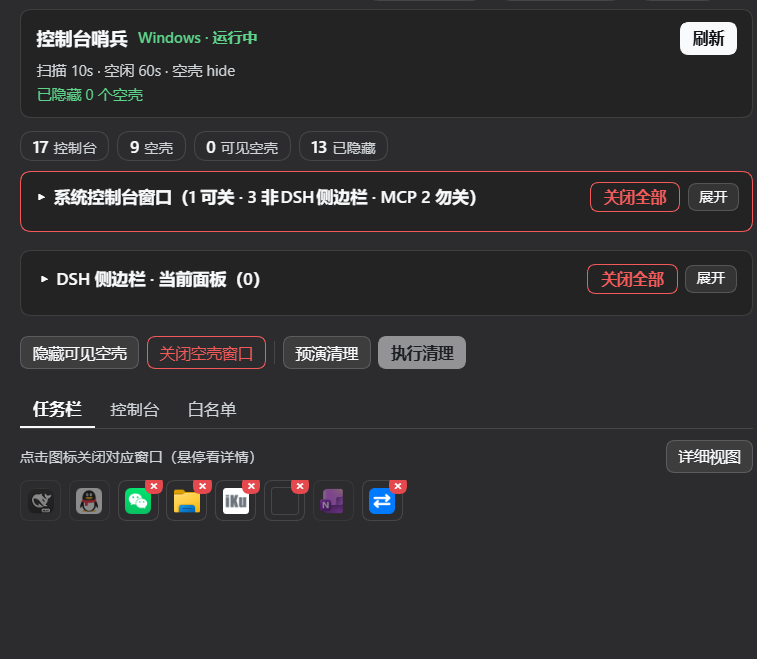
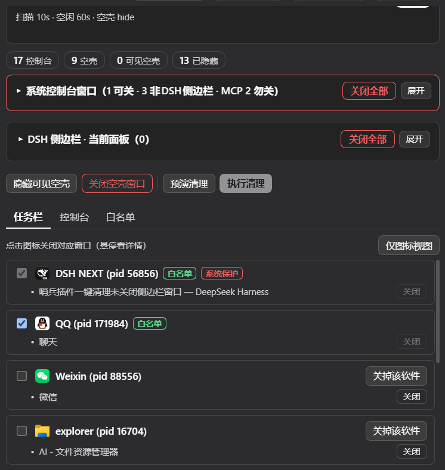
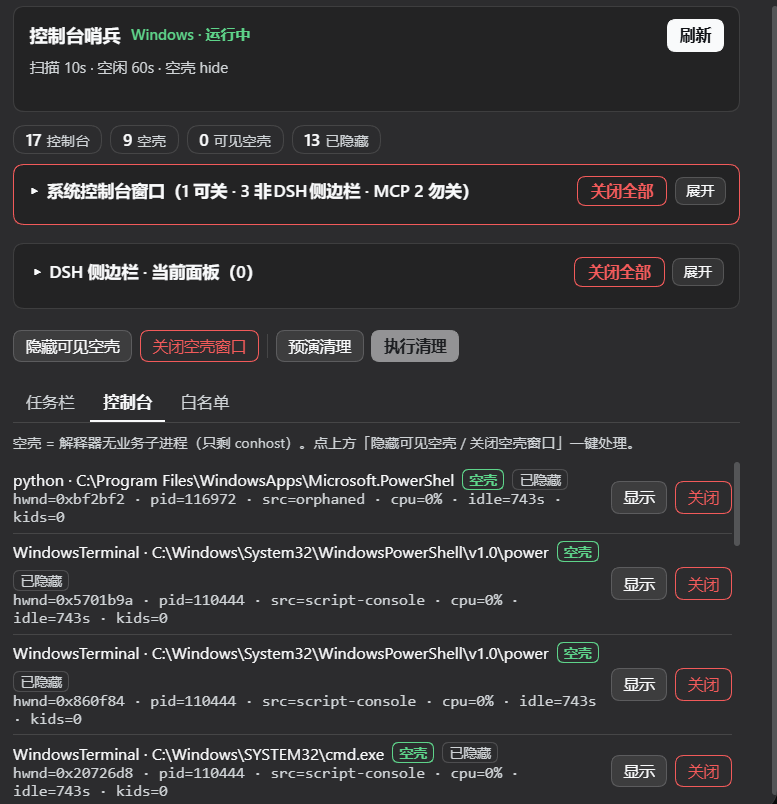
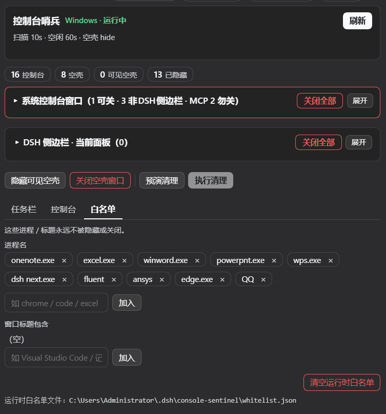

# dsh-console-sentinel

> **功能描述**：桌面控制台哨兵：扫描所有控制台窗口，标出哪些已空闲或跑完，一键关闭非白名单窗口，关之前先干跑预览再确认。白名单按进程名或窗口标题子串逐条添加，宿主进程默认受保护。v1.1.0 起设置面板顶部并列两张**默认折叠**卡片——「系统控制台窗口（N 可关 · M 非DSH侧边栏 · MCP n 勿关）」与「DSH 侧边栏 · 当前面板（N）」，各自可展开逐窗关闭、也可标题行一键全关；MCP 宿主服务标红「勿关」不提供关闭按钮；图标视图的可关窗口带红 X 角标可点即关；资源管理器文件夹窗口可单关（不杀 explorer，桌面/任务栏不受影响）。适配 DSH 内核 0.2.2-rc.1。

> 完整文档以 [English README](./README.md) 为准，本页提供中文导读与关键信息速查。

## 两个折叠卡片（v1.1.0）

设置面板顶部并列两张**默认折叠**卡片，点标题行任意位置展开；每张卡片的「全部关闭」都固定在标题行，折叠态也能一键关：

* **系统控制台窗口（N 可关 · M 非DSH侧边栏 · MCP n 勿关）**：只列可见的顶层控制台窗口，标题行自报三个数（可关闭 / 非 DSH 侧边栏总数 / MCP 服务数）。每行 `隐藏`（无损，进程继续跑）或 `关闭`（`WM_CLOSE`，等同 Alt+F4）；MCP 服务（进程名匹配 `mcp` / `agent-bridge` / `ansys-bridge`）标红「MCP服务·勿关」，**不渲染**关闭/隐藏按钮，「全部关闭」自动跳过。批量关闭时有 2px 进度条。
* **DSH 侧边栏 · 当前面板（N）**：只列**当前会话已 mounted** 的右侧栏面板（文件 / 终端 / Git / 预览…），每行带 kind 中文名 + tab 标识 + `关闭`；`关闭当前面板` 在标题行，折叠态也可一键关。数据来自宿主原生 API `ctx.sidebarRight.openTabs`，历史会话残留不展示（列出来也关不掉）。

## 主要能力

* 图标网格视图（默认）：可关窗口右上角带**红 X 角标**（tooltip「关闭此窗口」），点一下即关。
* 详细视图：按软件分组，显示完整标题、白名单勾选、`系统保护` / `管理员` 标记、`关掉该软件`（整软件关）与逐窗 `关闭`。
* 资源管理器文件夹窗口（`CabinetWClass` / `ExploreWClass`）可单关，**不 kill `explorer.exe`**，桌面 / 任务栏 / 开始菜单不受影响；桌面壳 7 类（`Progman` / `WorkerW` / `Shell_TrayWnd` / `Shell_SecondaryTrayWnd` / `DV2ControlHost` / `MsgrimeWindowClass` / `SysShadow`）硬拒绝，返回 `desktop-shell`。
* 空壳控制台清理：只针对 `cmd` / `powershell` / `pwsh` / `python`，可隐藏（无损）或真关；已隐藏的仍带 `已隐藏` 标记留在列表里。
* 预演优先：`执行清理` 在 `预演清理` 之前是禁用的，最后还有一次 yes/no 确认。









## 生效方式

* `lib/client.js`（双卡、紧凑化、红X角标）→ **Ctrl+Shift+R 硬刷新**（Ctrl+R 只从内存缓存重载）。
* `lib/index.js` / `lib/logic.js`（`folderWindows` getter 修复、文件夹窗口可关、桌面壳红线）→ **彻底退出 DSH 客户端再启动**（宿主无热重载）。

## How it works

本节内容详见 [English README](./README.md)。

## Install

```bash
dsh plugin --profile desktop add dsh-console-sentinel
```

Windows only. 本节其余内容详见 [English README](./README.md#install)。

## Tools (model-visible)

本节内容详见 [English README](./README.md#tools-model-visible)。

## Config (cordis.yml)

本节内容详见 [English README](./README.md#config-cordisyml)。

## Safety

本节内容详见 [English README](./README.md#safety-model)。

## Development

本节内容详见 [English README](./README.md#development)。
