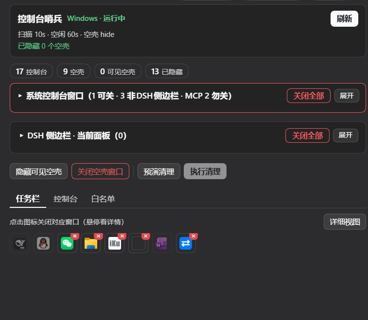
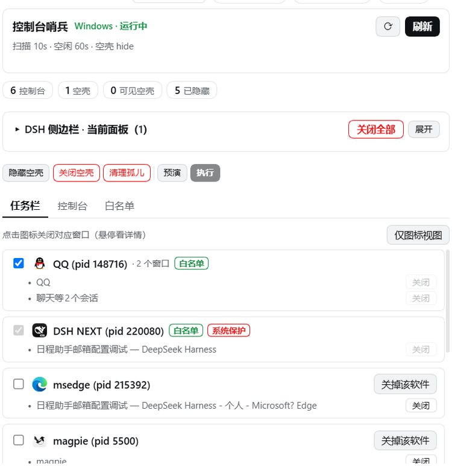
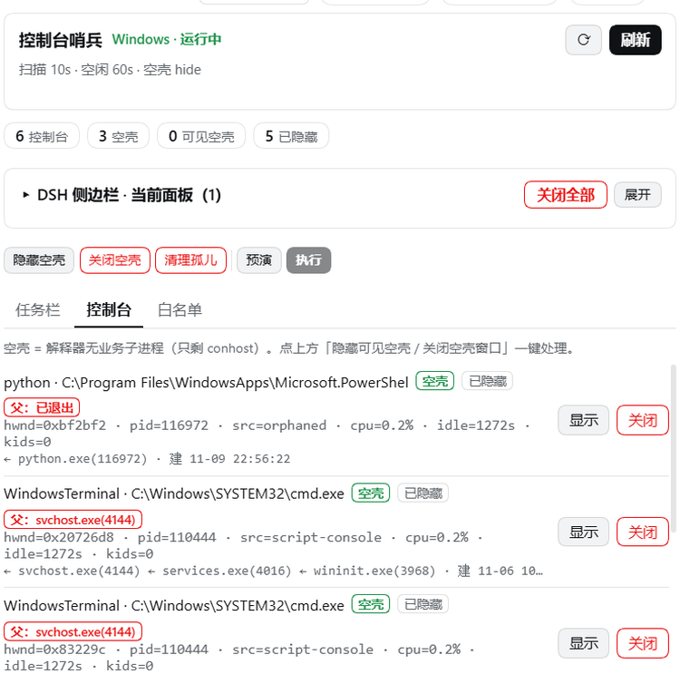
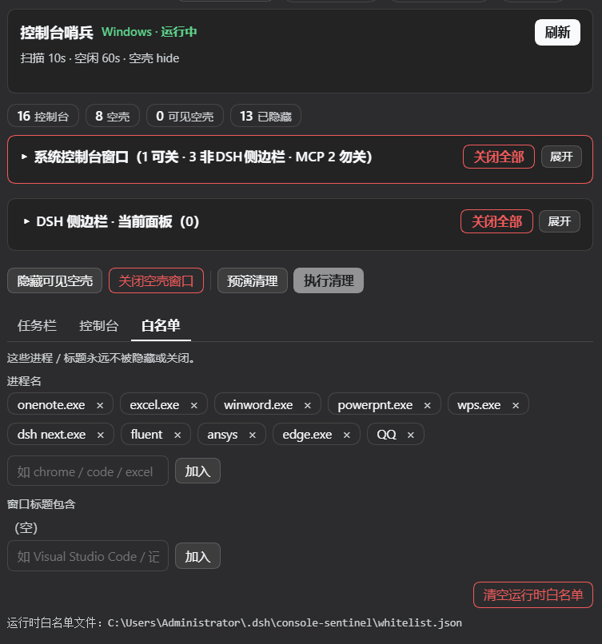

# dsh-console-sentinel

> **功能描述**：桌面控制台哨兵：扫描所有控制台窗口，标出哪些已空闲或跑完，一键关闭非白名单窗口，关之前先干跑预览再确认。白名单按进程名或窗口标题子串逐条添加，宿主进程默认受保护。**v1.4.3 起只在打开设置面板时运行**：面板关着一个 PowerShell 都不起，面板可见时每 30 s 一次轻量心跳刷新，单次探测从 ~9 s 压到 ~1-2 s。设置面板顶部并列两张**默认折叠**卡片（当前版本 v1.4.1）——「系统控制台窗口（N 可关 · M 非DSH侧边栏 · MCP n 勿关）」与「DSH 侧边栏 · 当前面板（N）」，各自可展开逐窗关闭、也可标题行一键全关；MCP 宿主服务标红「勿关」不提供关闭按钮；图标视图的可关窗口带红 X 角标可点即关；资源管理器文件夹窗口可单关（不杀 explorer，桌面/任务栏不受影响）。适配 DSH 内核 0.2.2-rc.1。**v1.3.7 起另带「本地AI」页签**：列出当前**真正占着显存**的本地大模型服务（ComfyUI / MOSS / llama.cpp / Ollama / LM Studio / vLLM / YuE2 / CosyVoice / 换脸 / 超分……），可按需**安全释放**显存——先卸载模型（服务继续跑、下次自动重载），不行再优雅关闭，最后才强制结束；网关与额度中转站只计数、不列、不动。
>
> **English**: Desktop console watchdog: scans every console window, marks which ones are idle or finished, and closes the non-whitelisted ones in one click, with a dry-run preview and a confirm step before anything closes. Whitelist entries are one row each by process image name or window-title substring, and shell hosts are protected by default. Since v1.1.0 the settings panel opens with two collapsible cards — "System console windows (N closable · M non-DSH-sidebar · MCP n protected)" and "DSH sidebar · current panels (N)" — each expandable for per-window closing or closable in one click from its title row; MCP host services are flagged protected with no close button; closable windows in the icon grid carry a red X badge; File Explorer folder windows can be closed individually without killing explorer.exe, so the desktop and taskbar stay up. Adapts DSH kernel 0.2.2-rc.1.

> ⚠️ **版本说明（2026-11-13）**：1.3.2 及更早版本的「自动隐藏」在失败时会**每 10 秒写一条日志**、`reason` 恒为 `unknown`（本机实测一小时 208 条）。1.3.4 起：probe 按证据给出 `stale-handle` / `still-visible` / `unknown-state`，失败记账并指数退避（封顶 10 分钟），连续 3 次进 30 分钟冷却，日志改为首次 `warn`（带 pid/标题/窗口类/是否提权）+ 每 10 分钟或每 60 次一条汇总。1.3.5 另修 `console_windows_list` 工具：输出 schema 少了 `trace` 字段，导致每次调用都被宿主按 `additionalProperties: false` 拒收。
>
> **Status (2026-11-13)**: On 1.3.2 and earlier, auto-hide wrote one log line every 10 s for the same window with `reason` hard-coded to `unknown` (208 entries in an hour on this machine). Since 1.3.4 the probe classifies failures as `stale-handle` / `still-visible` / `unknown-state`, tracks them with exponential backoff (capped at 10 min), enters a 30-minute cooldown after three consecutive failures, and logs one `warn` with full identity plus periodic summaries. 1.3.5 also fixes `console_windows_list`, whose output schema omitted `trace` and made every call fail host-side validation.


[](https://www.npmjs.com/package/dsh-console-sentinel)
[](./LICENSE)


A **DSH (DeepSeek Harness) plugin for Windows** that cleans up your taskbar in one click:
close every window of an app the way **Alt+F4** would (graceful `WM_CLOSE`, not a force-kill),
close leftover **empty console shells**, close the **panels the DSH sidebar still has open**, and
never touch the harness itself or an in-progress Fluent / MPI solver run.

> 中文说明见 [README.zh.md](./README.zh.md)



## Why

Windows accumulates windows you no longer need: empty PowerShell/cmd shells left behind by
tooling, terminals you forgot about, apps you closed the document for but not the program — and a
DSH sidebar that keeps every panel you ever opened. Closing them one by one is tedious, and a
careless "kill everything" script will happily take down your harness or a running CFD job.

This plugin does the closing **safely**:

* it closes **gracefully** (`WM_CLOSE`, exactly what Alt+F4 sends) so apps can save and exit;
* it closes **per window, per app, or as a batch** — no clicking through every window;
* it **never** closes the DSH host, MCP host services, or Fluent / MPI / ANSYS solver processes;
* it can close **elevated (admin) windows** too, via a single UAC prompt;
* it closes **DSH sidebar panels** through the host API, so only panels that really are mounted
  and really can be closed are listed.

## Features

### Two collapsible cards at the top of the panel

Both cards are **collapsed by default** (compact by design) and expand on a click anywhere on the
title row; each has its own one-click "close all" on that same row, so you never have to expand
first:

* **系统控制台窗口（N 可关 · M 非DSH侧边栏 · MCP n 勿关）** — every visible top-level console
  window that is not the DSH sidebar. The title reports three numbers: closable windows, the total
  count, and how many are MCP host services. Per row you get `隐藏` (lossless) or `关闭`
  (`WM_CLOSE`); MCP services are flagged **MCP服务·勿关** in red and get **no** close/hide buttons
  at all, and "close all" skips them — closing one takes the tool bridge down with it. A 2px bar
  under the title shows batch-close progress.
* **DSH 侧边栏 · 当前面板（N）** — the panels the sidebar currently has **mounted in this
  session** (file / terminal / Git / preview …), with a kind label, the tab id, and per-panel
  `关闭`; `关闭当前面板` sits on the title row so it works while collapsed.

### One-click taskbar cleanup (preview first)

`预演清理` lists exactly which windows would be closed (with icons), `执行清理` then closes them.
Execute stays disabled until you have previewed — no blind destructive clicks. The final confirm is
a single yes/no prompt.

### Taskbar windows, grouped by app

The **icon grid** view (default) packs every window into a compact 36×36 grid with a 24px app
icon; when an .exe icon cannot be extracted the cell falls back to the process-name initial
instead of a blank box, and the process path is back-filled through `Win32_Process.ExecutablePath`
(the host-side icon lookup). Closable windows
carry a **red X badge** in the top-right corner (`关闭此窗口`) so a single click closes that window
without opening anything else. Switch to **detail view** for a per-app card with full titles, a
whitelist checkbox, `关掉该软件` (close the whole app), and a per-window `关闭` button.



### Explorer folder windows

File Explorer folder windows (`CabinetWClass` / `ExploreWClass`) are listed and can be closed
individually. They are closed at the **window** level with `WM_CLOSE` — `explorer.exe` keeps
running, so the desktop, taskbar and Start menu are unaffected. Desktop shell surfaces
(`Progman`, `WorkerW`, `Shell_TrayWnd`, `Shell_SecondaryTrayWnd`, `DV2ControlHost`,
`MsgrimeWindowClass`, `SysShadow`) are hard-refused and reported as `desktop-shell`. The automatic
empty-shell sweep never includes folder windows.

### Empty console shell cleanup

A shell with no working child process (just `conhost`) is an "empty shell". Hide them
(lossless, the process keeps running) or close them for real — only bare
`cmd` / `powershell` / `pwsh` / `python` are ever targeted. Hidden shells stay listed with an
`已隐藏` marker so nothing disappears silently.



### Provenance: who spawned this console

Every console row now carries a second line besides `src=` (source type):

`← WmiPrvSE.exe(10384) ← svchost.exe(4144) · script monitor_writer_xxx.ps1 · since 11-06 10:47:36`

* **Parent chain** — up to 6 levels upward from the window's own process (full chain on hover).
  Seeing `← WmiPrvSE.exe` means it was created through WMI's `Win32_Process.Create`, the usual path for
  background/boot-time scripts. Seeing `← explorer.exe` means a human double-clicked it.
* **Script** — recognised from the command line (`-File <x>.ps1` or a drive-absolute
  `.(ps1|bat|cmd|py|vbs|js)` path). The row shows the file name; hover shows the absolute path and the
  **full command line** (truncated past 600 chars).
* **Start time** — when the process was created, so "is this the same one that has been running since
  10:47" becomes a fact instead of a guess.

**Boundary:** `src=wmi-detached` only proves the parent is WmiPrvSE; **"which caller invoked WMI" is not
retrievable** — the `Microsoft-Windows-WMI-Activity/Operational` record carrying `ClientProcessId` gets
flushed by high-frequency query traffic. To find the culprit, read the **script path in the command line**:
that is the fingerprint the caller leaves behind.

### Red 父：chips + one-click orphan cleanup

Every row now also shows a **red parent chip** next to the process name: `父：svchost.exe(4144)` when the parent is alive, or `父：已退出` for an orphan whose parent already exited (hover for the parent's full command line).

The **Clean orphan windows** button in the action bar monitors and closes console windows whose parent has exited but which kept running — **a confirmation list is always shown before anything is closed**. Safe mode: only bare interpreters (`cmd`/`powershell`/`pwsh`/`python`) with **no working child process** and **not compute-related** are touched; `mpiexec` / `fluent` / `fl2610` / `cx2610` / `ansys` / `node` are **never** closed — a running Fluent's mpiexec can also have an exited parent, and it will not be killed by mistake.

### Persistent whitelist

Programs and window-title keywords that must never be hidden or closed. Stored in
`~/.dsh/console-sentinel/whitelist.json`, editable from the panel or the tools. The whitelist page
also carries a system-protection row per entry, so you can see what the plugin protects on its own
before you add anything.



### Local AI: release VRAM safely (since v1.3.7, stable in v1.4.1)

The fourth tab, **Local AI**, answers "a local model finished and is still holding VRAM, but killing it
means I have to restart everything".

**Identification never depends on the install directory** — it works on another machine, or on a
deployment someone else put on a different drive. Three independent kinds of evidence:

| Evidence | What it covers |
|---|---|
| **Real VRAM holders** | the PID set from `nvidia-smi --query-compute-apps` (a GPU context is *not* the same thing as used VRAM — only this counts) |
| **Name / path / command-line regex** | 28 families: llama.cpp, Ollama, LM Studio, vLLM, SGLang, ComfyUI, SD WebUI, Gradio, MOSS, YuE2, CosyVoice, GPT-SoVITS, Whisper, face swap, upscalers… |
| **Listening ports** | 8188/8190 ComfyUI, 7860–7871 Gradio family, 8099 llama-server, 11434 Ollama, 1234 LM Studio… |

Only **local model servers** are listed. Gateways and quota relays (`tier_router`, Agent2API, magpie,
LiteLLM, Open WebUI…) are **counted, never listed, never touched** — that reclassification is the whole
point of v1.4.1, which fixed them being released as if they were models.

**Three release levels, gentlest first:**

| Level | Method | Outcome |
|---|---|---|
| L1 | HTTP unload (ComfyUI `POST /free {"unload_models":true}`, Ollama `keep_alive:0`) | **model unloaded, service keeps running**, reloads automatically next time |
| L2 | `WM_CLOSE` (`taskkill /PID n` **without** `/F`, same as Alt+F4) | the app shuts itself down cleanly |
| L3 | `taskkill /PID n /T /F` (**only** that pid and its descendants) | forced, and the result says "forced" explicitly |

**A live gateway means automatic reload.** As long as the gateway that owns the backend is still
listening (typically `tier_router` on 8080), the next request brings the model back by itself — no manual
restart. The panel notes state this outright: *"gateway port 8080 is listening — the next request will
reload the model automatically"*. If the gateway is already dead, it tells you to start the router script
first, instead of letting you believe release is self-recovering.

The per-row **End** button runs the same three-level chain — it is never a bare force kill. Protected
entries (DSH host, Electron, Fluent/MPI, system components) get no button at all. Per-process VRAM is
only available when elevated (WDDM restriction); otherwise total process memory is shown.

## Safety model

Bulk-closing windows is a destructive operation, so the plugin layers several hard guards:

| Guard | Behaviour |
|---|---|
| **Host process tree** | The DSH host, all its ancestors, and every descendant (`dsh` / `electron` / `deepseek` images) are never touched — closing one of those consoles can take the harness down. |
| **MCP host services** | Console windows whose process matches `mcp` / `agent-bridge` / `ansys-bridge` are flagged **MCP服务·勿关**: no close/hide buttons, skipped by "close all". |
| **Compute protection** | `mpi` / `fluent` / `ansys` / `cx*` / `solver` / `cae` / `launcher` are never selected. An `mpiexec` console looks like a plain window but killing it ends a running simulation. |
| **Desktop shell red line** | `Progman` / `WorkerW` / `Shell_TrayWnd` / `Shell_SecondaryTrayWnd` / `DV2ControlHost` / `MsgrimeWindowClass` / `SysShadow` are refused with reason `desktop-shell` — closing them removes the desktop, taskbar or IME. |
| **Explorer stays alive** | Folder windows (`CabinetWClass` / `ExploreWClass`) close at the hwnd level; `explorer.exe` is never killed. |
| **Bare-interpreter only** | Empty-shell closing is restricted to `cmd` / `powershell` / `pwsh` / `python`. |
| **Foreground & self** | The focused window and the plugin's own process are skipped. |
| **Whitelist** | Anything you tick is permanently exempt. |

**Closing windows** uses graceful `WM_CLOSE` everywhere; `taskkill /F` is deliberately **not** offered there.
The only forced path is the Local AI tab's L3 release — scoped to the single pid you picked and its
descendants, reached only after L1 unload and L2 graceful close both fail, and the result says "forced".

## Elevated (admin) windows

A non-elevated process cannot close an elevated window — Windows UIPI silently drops the message,
which looks like "the button does nothing". When you close an admin window (Task Manager,
screen recorders, …) the plugin starts **one** elevated helper: you get a single UAC prompt, it
sends the same `WM_CLOSE`, and reports back through a temp file (an elevated child's stdout is
not readable). Answer **No** and nothing happens — the plugin says so instead of pretending success.

## Install

```bash
dsh plugin --profile desktop add dsh-console-sentinel
```

Windows only. Declares `dsh.bundle` (host half) and `dsh.client` (settings-panel half), so it shows
up under **Settings → 控制台哨兵** with a terminal icon.

## Configuration

Defaults in `cordis.patch.yml`:

| Key | Default | Meaning |
|---|---|---|
| `scanIntervalSec` | `10` | probe interval |
| `idleThresholdSec` | `60` | how long a console must idle before it counts as empty |
| `cpuThresholdPct` | `1` | CPU floor for the idle test |
| `autoAction` | `none` | `none` \| `hide` \| `close` for idle consoles |
| `emptyConsoleAction` | `hide` | action for empty shells |
| `guardForeground` | `true` | never touch the focused window |
| `cleanup.protectedProcesses` | see above | never closed by the desktop cleanup |
| `whitelist.processes` / `.titles` / `.unprotect` | `[]` | runtime-managed exemptions |

## Tools

Host-side tools for scripted use: `console_windows_list`, `console_windows_action`,
`console_windows_sweep`, `desktop_windows_cleanup`, `sentinel_whitelist` for the exemption list, and
`ai_release_local_vram` for releasing local-model VRAM (`dryRun` / `mode` / `gpuOnly` / `protectPids`).
A CLI is available via `lib/desktop-cli.mjs list|cleanup`.

## Licence

MIT
