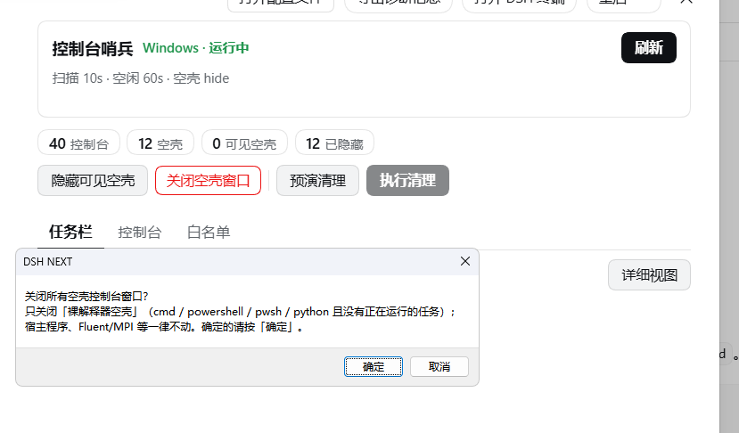
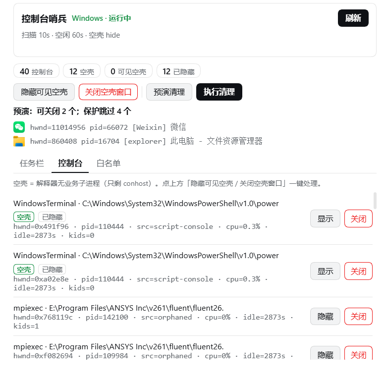
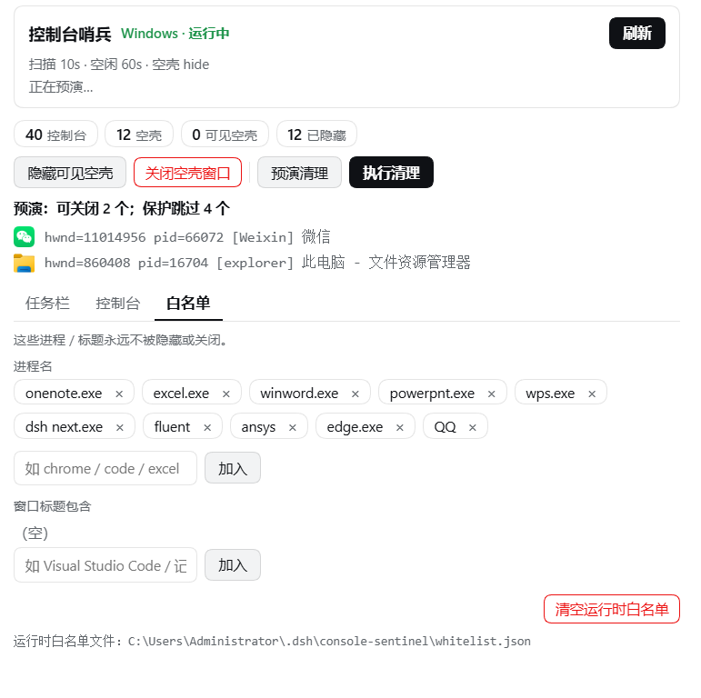

# dsh-console-sentinel

[](https://www.npmjs.com/package/dsh-console-sentinel)
[](./LICENSE)


A **DSH (DeepSeek Harness) plugin for Windows** that cleans up your taskbar in one click:
close every window of an app the way **Alt+F4** would (graceful `WM_CLOSE`, not a force-kill),
close leftover **empty console shells**, and never touch the harness itself or an in-progress
Fluent / MPI solver run.

> 中文说明见 [README.zh.md](./README.zh.md)


---

## Why

Windows accumulates windows you no longer need: empty PowerShell/cmd shells left behind by
tooling, terminals you forgot about, apps you closed the document for but not the program.
Closing them one by one is tedious, and a careless "kill everything" script will happily take
down your harness or a running CFD job.

This plugin does the closing **safely**:

* it closes **gracefully** (`WM_CLOSE`, exactly what Alt+F4 sends) so apps can save and exit;
* it closes **per window, per app, or as a batch** — no clicking through every window;
* it **never** closes the DSH host, and never closes Fluent / MPI / ANSYS solver processes;
* it can close **elevated (admin) windows** too, via a single UAC prompt.

## Features

### One-click taskbar cleanup (preview first)

`预演清理` lists exactly which windows would be closed (with icons), `执行清理` then closes them.
Execute stays disabled until you have previewed — no blind destructive clicks.


### Taskbar windows, grouped by app

The **icon grid** view (default) packs every window into a compact 30×30 grid — one click closes
that window. Switch to **detail view** for a per-app card with full titles, a whitelist checkbox,
`关掉该软件` (close the whole app), and a per-window `关闭` button.


Every close is confirmed first:



### Empty console shell cleanup

A shell with no working child process (just `conhost`) is an "empty shell". Hide them
(lossless, the process keeps running) or close them for real — only bare
`cmd` / `powershell` / `pwsh` / `python` are ever targeted.



### Persistent whitelist

Programs and window-title keywords that must never be hidden or closed. Stored in
`~/.dsh/console-sentinel/whitelist.json`, editable from the panel or the tools.



## Safety model

Bulk-closing windows is a destructive operation, so the plugin layers several hard guards:

| Guard | Behaviour |
|---|---|
| **Host process tree** | The DSH host, all its ancestors, and every descendant (`dsh` / `electron` / `deepseek` images) are never touched — closing one of those consoles can take the harness down. |
| **Compute protection** | `mpi` / `fluent` / `ansys` / `cx*` / `solver` / `cae` / `launcher` are never selected. An `mpiexec` console looks like a plain window but killing it ends a running simulation. |
| **Bare-interpreter only** | Empty-shell closing is restricted to `cmd` / `powershell` / `pwsh` / `python`. |
| **Foreground & self** | The focused window and the plugin's own process are skipped. |
| **Whitelist** | Anything you tick is permanently exempt. |

Graceful close (`WM_CLOSE`) is used everywhere; `taskkill /F` is deliberately **not** offered.

## Elevated (admin) windows

A non-elevated process cannot close an elevated window — Windows UIPI silently drops the message,
which looks like "the button does nothing". When you close an admin window (Task Manager,
screen recorders, …) the plugin starts **one** elevated helper: you get a single UAC prompt, it
sends the same `WM_CLOSE`, and reports back through a temp file (an elevated child's stdout is
not readable). Answer **No** and nothing happens — the plugin says so instead of pretending success.

## Install

```bash
dsh plugin --profile desktop add dsh-console-sentinel
```

Windows only. Declares `dsh.bundle` (host half) and `dsh.client` (settings-panel half), so it shows
up under **Settings → 控制台哨兵** with a terminal icon.

## Configuration

Defaults in `cordis.patch.yml`:

| Key | Default | Meaning |
|---|---|---|
| `scanIntervalSec` | `10` | probe interval |
| `idleThresholdSec` | `60` | how long a console must idle before it counts as empty |
| `cpuThresholdPct` | `1` | CPU floor for the idle test |
| `autoAction` | `none` | `none` \| `hide` \| `close` for idle consoles |
| `emptyConsoleAction` | `hide` | action for empty shells |
| `guardForeground` | `true` | never touch the focused window |
| `cleanup.protectedProcesses` | see above | never closed by the desktop cleanup |
| `whitelist.processes` / `.titles` / `.unprotect` | `[]` | runtime-managed exemptions |

## Tools

Host-side tools for scripted use: `console_windows_list`, `console_windows_action`,
`console_windows_sweep`, `desktop_windows_cleanup`, plus `sentinel_whitelist` for the
exemption list. A CLI is available via `lib/desktop-cli.mjs list|cleanup`.

## Licence

MIT
