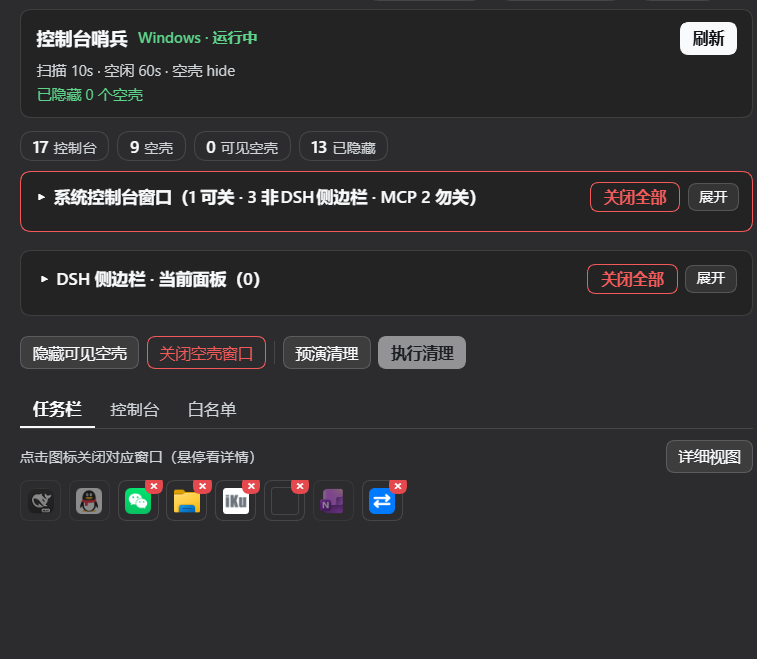
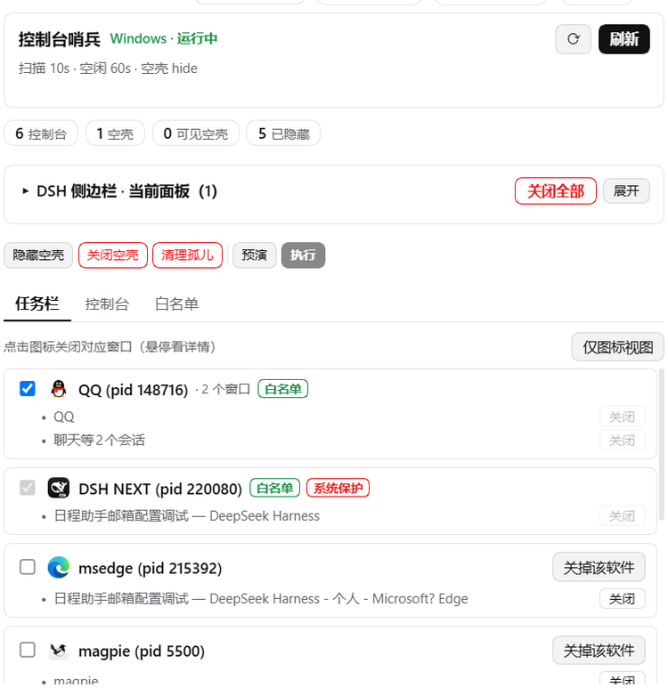
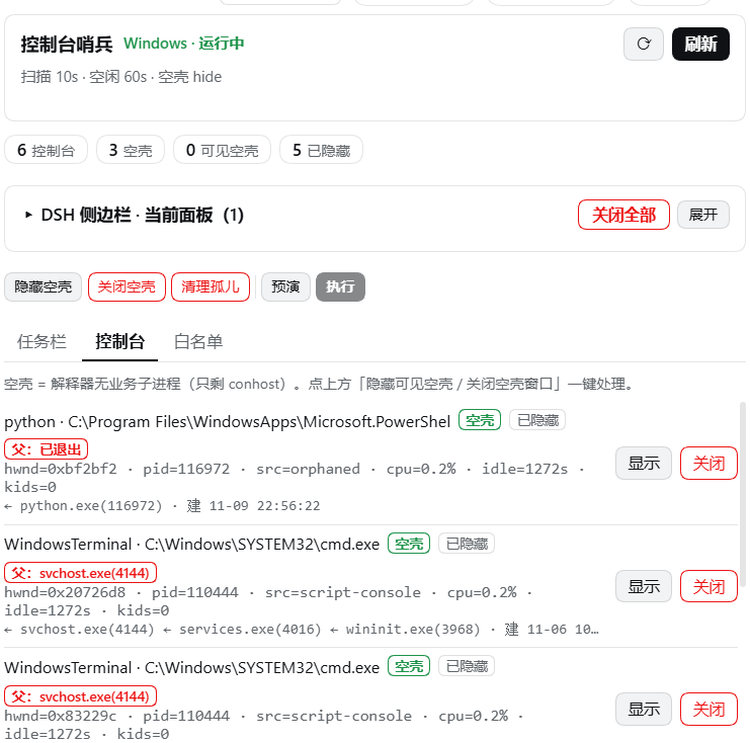
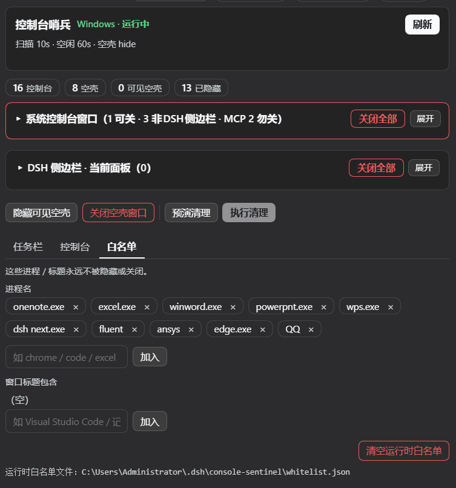

# dsh-console-sentinel

[](https://www.npmjs.com/package/dsh-console-sentinel)
[](./LICENSE)


**DSH（DeepSeek Harness）Windows 插件**：一键清理任务栏窗口——按软件整体关闭、
关掉残留的空壳控制台、关掉 DSH 右侧边栏还开着没关的面板，关闭方式等同于对每个窗口按
**Alt+F4**（优雅 `WM_CLOSE`，非强杀），并且**绝不碰 DSH 宿主本身、MCP 宿主服务、也绝不碰正在计算的 Fluent / MPI**。

> English: [README.md](./README.md)



---

## 为什么需要它

Windows 上总会攒下一堆不再需要的窗口：工具留下的空 PowerShell / cmd 空壳、忘了关的终端、
文档关了但程序还开着的软件。一个个点太麻烦，而粗暴的"全杀掉"脚本又会顺手带走你的宿主或正在跑的 CFD。

这个插件**安全地**帮你关：

* **优雅关闭**（`WM_CLOSE`，正是 Alt+F4 发出的消息），软件能正常保存退出；
* 支持**按窗口 / 按软件 / 批量**三种粒度，不用挨个点；
* **永不关闭** DSH 宿主，**永不关闭** Fluent / MPI / ANSYS 求解器进程；
* 支持关闭**管理员权限窗口**——弹一次 UAC 即可。

## 功能

### 顶部两张折叠卡片（默认折叠）

设置面板顶部并列两张卡片，**默认折叠**（界面更紧凑），点标题行任意位置展开；每张卡片的「全部关闭」都固定在标题行，**折叠态也能一键关**：

* **系统控制台窗口（N 可关 · M 非DSH侧边栏 · MCP n 勿关）**：标题行自报三个数——可关闭数 / 非 DSH 侧边栏总数 / MCP 服务数。每行 `隐藏`（无损）或 `关闭`（`WM_CLOSE`）；MCP 服务（进程名匹配 `mcp` / `agent-bridge` / `ansys-bridge`）标红「MCP服务·勿关」，**不渲染**关闭/隐藏按钮，「全部关闭」自动跳过——它们是 DSH 宿主服务，关掉会把工具链一起带走。批量关闭时标题下方有 2px 进度条。
* **DSH 侧边栏 · 当前面板（N）**：只列**当前会话已 mounted** 的右侧栏面板（文件 / 终端 / Git / 预览…），每行带 kind 中文名 + tab 标识 + `关闭`；`关闭当前面板` 在标题行，折叠态也可一键关。数据来自宿主原生 API `ctx.sidebarRight.openTabs`；历史会话残留不展示（宿主对未 adopt 的历史会话 `closeIn` 是静默空转，列出来也关不掉）。

### 一键清理任务栏窗口（先预演）

`预演清理` 列出将被关闭的窗口（带图标），核对无误再点 `执行清理`。
**没预演时「执行清理」是禁用的**——不会让你盲着执行破坏性操作。最后一次确认是系统 yes/no 提示。

### 任务栏窗口 · 按软件分组

默认是 **仅图标视图**：每个窗口压成一个 **36×36 图标格**（图标 24px）；取不到窗口图标时不显示空白格，改为显示**进程名首字母**（鼠标悬停看完整进程名），进程路径由宿主侧 `Win32_Process.ExecutablePath` 回填。可关闭的窗口右上角带**红色小 X 角标**（tooltip「关闭此窗口」），点一下即关闭该窗口，不必进详细视图。
切到 **详细视图** 则按软件分组显示完整标题、白名单勾选框、`系统保护` / `管理员` 标记、`关掉该软件`（整个软件一次关掉）以及每个窗口独立的 `关闭` 按钮。



### 资源管理器文件夹窗口

文件夹窗口（`CabinetWClass` / `ExploreWClass`）现在可单独关闭：按 **hwnd** 发 `WM_CLOSE`，**不 kill `explorer.exe`**——桌面、任务栏、开始菜单都不受影响。桌面壳 7 类（`Progman` / `WorkerW` / `Shell_TrayWnd` / `Shell_SecondaryTrayWnd` / `DV2ControlHost` / `MsgrimeWindowClass` / `SysShadow`）硬拒绝，返回 `desktop-shell` 原因码；自动空壳扫描永不含文件夹窗口。

### 空壳控制台清理

没有业务子进程（只剩 `conhost`）的解释器窗口即"空壳"。可以**隐藏**（无损，进程继续跑），
也可以**真正关闭**——且只针对裸 `cmd` / `powershell` / `pwsh` / `python`。已隐藏的空壳仍留在列表里并带 `已隐藏` 标记，不会无声消失。



### 溯源：每个窗口是谁拉起来的

每个控制台窗口除了 `src=`（来源类型），再加一行**溯源**：

`← WmiPrvSE.exe(10384) ← svchost.exe(4144) · 脚本 monitor_writer_xxx.ps1 · 建 11-06 10:47:36`

* **父进程链**：最多 6 层，从自身往上（hover 看全链）。看到 `← WmiPrvSE.exe` 就知道它是被 WMI 的
  `Win32_Process.Create` 拉起来的——后台脚本/服务端常走这条路。
* **脚本**：从命令行里认出 `-File <x>.ps1` 或 `盘符:\...\.(ps1|bat|cmd|py|vbs|js)`，行上只给**文件名**，
  hover 看**绝对路径**与**命令行全文**（超 600 字符截断）。
* **创建时间**：进程启动时刻，用来判断「它是不是从早上 10:47 一直活到现在」。

**能力边界**：`src=wmi-detached` 只能证明「父亲是 WmiPrvSE」，**「谁调用了 WMI」不可回溯**——
`Microsoft-Windows-WMI-Activity/Operational` 里那条带 `ClientProcessId` 的 `Win32_Process::Create`
会被高频查询冲掉。要定位始作俑者，看**命令行里的脚本路径**（那是调用方留下的指纹）。

### 父：「红字」标识 + 一键清理孤儿窗口

每个窗口在进程名旁多一个**红字 chip**：有父进程 → `父：svchost.exe(4144)`；父进程已退出（孤儿）→ `父：已退出`（hover 看父进程命令行全文）。

操作栏「清理孤儿窗口」按钮 = 一键监测并关闭「父进程已退出、但自身还在」的控制台，**先弹确认清单再关**。安全模式：只关**无业务子进程 + 非计算类**的裸解释器孤儿（`cmd`/`powershell`/`pwsh`/`python`）；`mpiexec` / `fluent` / `fl2610` / `cx2610` / `ansys` / `node` 等计算类**一律不碰**——正在算的 Fluent 其 mpiexec 也可能父已退出，绝不会被误关。

### 持久化白名单

进程名与窗口标题关键字，命中即永不隐藏、永不关闭。存于
`~/.dsh/console-sentinel/whitelist.json`，面板里点标签即可增删。白名单页同时带 `系统保护` 展示，逐条标明这个插件自己在保护哪些东西。



## 安全模型

批量关窗口是不可逆操作，因此叠加了多重硬保护：

| 保护层 | 行为 |
|---|---|
| **宿主进程树** | DSH 宿主本身、其全部祖先、以及所有 `dsh` / `electron` / `deepseek` 进程**及其全部后代**永不触碰——关掉其中某个控制台会连带把宿主杀掉。 |
| **MCP 宿主服务** | 进程名匹配 `mcp` / `agent-bridge` / `ansys-bridge` 的控制台标红「MCP服务·勿关」：无关闭/隐藏按钮，「全部关闭」跳过。 |
| **计算保护** | `mpi` / `fluent` / `ansys` / `cx*` / `solver` / `cae` / `launcher` 一律不选。`mpiexec` 的控制台看上去像普通窗口，但它被杀就等于终止正在跑的仿真。 |
| **桌面壳红线（7 类）** | `Progman` / `WorkerW` / `Shell_TrayWnd` / `Shell_SecondaryTrayWnd` / `DV2ControlHost` / `MsgrimeWindowClass` / `SysShadow` 拒绝关闭并返回 `desktop-shell`——关掉 = 桌面 / 任务栏 / 输入法消失。 |
| **explorer 保活** | 文件夹窗口按 hwnd 关，`explorer.exe` 永不 kill。 |
| **只动裸解释器** | 空壳关闭仅限 `cmd` / `powershell` / `pwsh` / `python`。 |
| **前台与自身** | 当前焦点窗口、插件自身进程一律跳过。 |
| **白名单** | 你勾选过的软件永久豁免。 |

全链路只用优雅关闭（`WM_CLOSE`），**刻意不提供 `taskkill /F` 强杀**。

## 管理员窗口关不掉怎么办

普通权限进程无法关闭管理员窗口——Windows 的 UIPI 会把消息**静默丢弃**，表现就是"点了没反应"。
关这类窗口时（任务管理器、录屏工具等），插件会启动**一个**提权助手：你只会看到**一次** UAC，
它发出同样的 `WM_CLOSE`，并通过临时文件把结果回传（提权子进程的 stdout 是拿不到的）。
点「否」则什么都不做，插件会**如实告知失败**，而不是假装成功。

## 安装

```bash
dsh plugin --profile desktop add dsh-console-sentinel
```

仅支持 Windows。同时声明 `dsh.bundle`（宿主半边）与 `dsh.client`（设置面板半边），
装好后在 **设置 → 控制台哨兵** 出现，带自定义终端图标。

## 配置

`cordis.patch.yml` 默认值：

| 键 | 默认 | 含义 |
|---|---|---|
| `scanIntervalSec` | `10` | 扫描间隔（秒） |
| `idleThresholdSec` | `60` | 判定空闲所需的秒数 |
| `cpuThresholdPct` | `1` | 空闲判定的 CPU 下限 |
| `autoAction` | `none` | 空闲控制台动作：`none` / `hide` / `close` |
| `emptyConsoleAction` | `hide` | 空壳动作 |
| `guardForeground` | `true` | 不处理前台窗口 |
| `cleanup.protectedProcesses` | 见上表 | 桌面清理永不选中 |
| `whitelist.processes` / `.titles` / `.unprotect` | `[]` | 运行时豁免清单 |

## 工具

宿主侧工具：`console_windows_list`、`console_windows_action`、`console_windows_sweep`、
`desktop_windows_cleanup`，以及管理豁免清单的 `sentinel_whitelist`。
命令行：`lib/desktop-cli.mjs list|cleanup`。

## 许可

MIT
